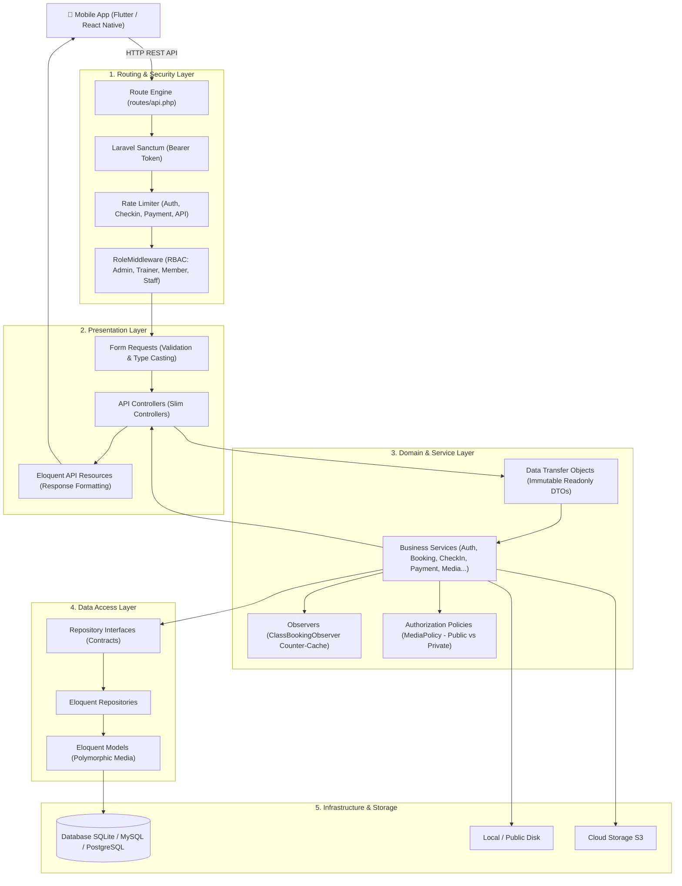
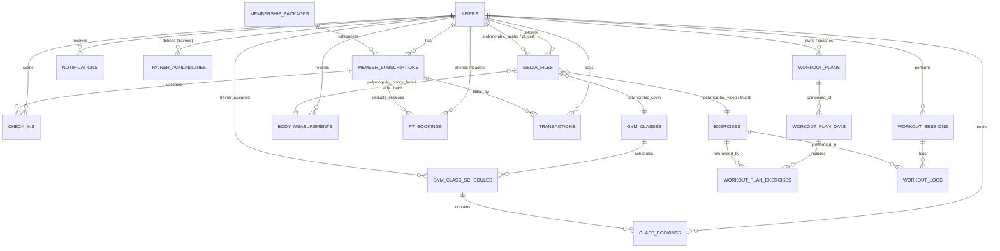
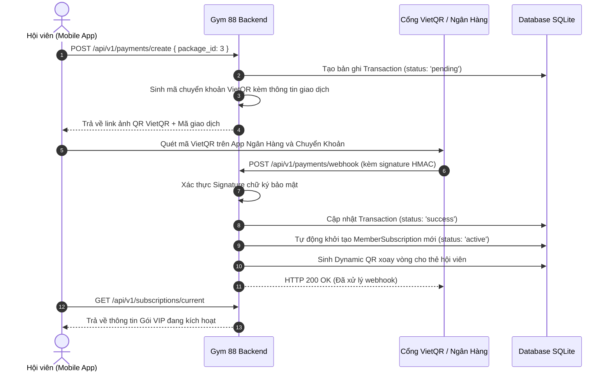
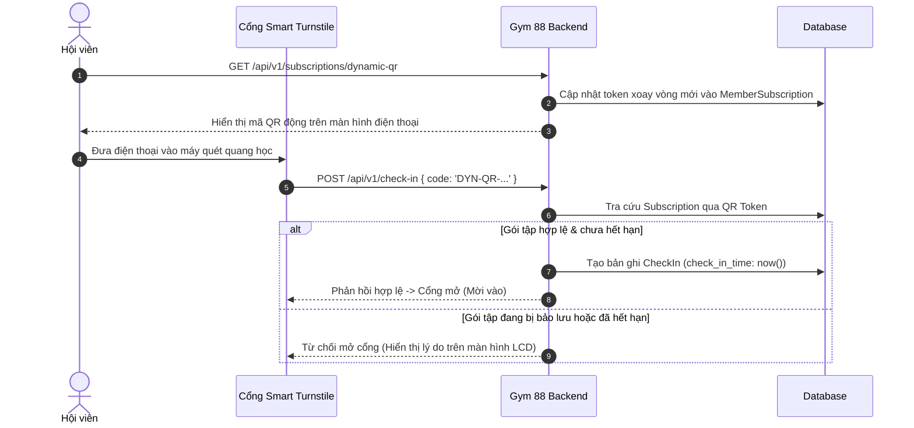
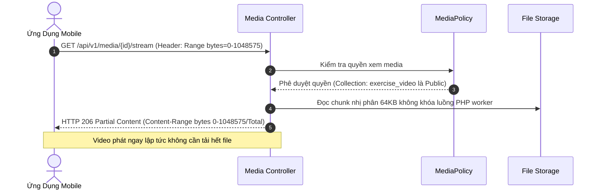

# 🏋️‍♂️ GYM 88 - Hệ Thống API Backend Cho Mobile App Quản Lý Phòng Tập

> Hệ thống RESTful API Backend chuyên nghiệp dành cho ứng dụng di động quản lý hội viên, huấn luyện viên, lịch tập luyện, lớp học nhóm và chỉ số cơ thể tại chuỗi phòng gym cao cấp.
> 
> Xây dựng trên nền tảng **Laravel 12**, tuân thủ kiến trúc phân tầng chuẩn doanh nghiệp: **MVC + Service Layer + Repository Pattern + DTOs + Observer Pattern + Form Requests + API Resources**.

---

## 📑 Mục lục
1. [Kiến Trúc Hệ Thống](#-kiến-trúc-hệ-thống)
2. [Sơ Đồ Thực Thể Quan Hệ (ERD)](#-sơ-đồ-thực-thể-quan-hệ-erd)
3. [Mô Tả Chi Tiết Cơ Sở Dữ Liệu (Data Dictionary)](#-mô-tả-chi-tiết-cơ-sở-dữ-liệu-data-dictionary)
4. [Sơ Đồ Luồng Nghiệp Vụ Chính](#-sơ-đồ-luồng-nghiệp-vụ-chính)
5. [Danh Sách 54 API Endpoints (v1)](#-danh-sách-54-api-endpoints-v1)
6. [Tài Khoản Mẫu Đã Cài Đặt (Seed Data)](#-tài-khoản-mẫu-đã-cài-đặt-seed-data)
7. [Hướng Dẫn Cài Đặt & Khởi Chạy](#-hướng-dẫn-cài-đặt--khởi-chạy)

---

## 🏛 Kiến Trúc Hệ Thống

Hệ thống được tổ chức phân tách độc lập các tầng trách nhiệm (Separation of Concerns):



---

## 📊 Sơ Đồ Thực Thể Quan Hệ (ERD)

Mô hình dữ liệu chuẩn hóa loại bỏ hoàn toàn việc phân mảnh dữ liệu. Bảng đa hình `media_files` là nguồn chân lý duy nhất (**Single Source of Truth**) cho toàn bộ ảnh đại diện, ảnh lớp, chứng chỉ PT, video bài tập và ảnh InBody.



---

## 📖 Mô Tả Chi Tiết Cơ Sở Dữ Liệu (Data Dictionary)

### 1. Bảng `users` (Người dùng & Nhân sự)
Lưu trữ thông tin tài khoản hội viên, huấn luyện viên (PT), nhân viên và ban quản trị.

| Tên Cột | Kiểu Dữ Liệu | Ràng Buộc / Mặc Định | Ý Nghĩa / Mô Tả |
| :--- | :--- | :--- | :--- |
| `id` | BIGINT UNSIGNED | PK, Auto Increment | Khóa chính |
| `name` | VARCHAR(255) | NOT NULL | Họ và tên người dùng |
| `email` | VARCHAR(255) | UNIQUE, NOT NULL | Địa chỉ email đăng nhập |
| `phone` | VARCHAR(255) | UNIQUE, NULLABLE | Số điện thoại đăng nhập & liên hệ |
| `password` | VARCHAR(255) | NOT NULL | Mật khẩu băm (Bcrypt) |
| `role` | VARCHAR(50) | DEFAULT 'member', INDEX | Vai trò: `admin`, `manager`, `staff`, `trainer`, `member` |
| `gender` | VARCHAR(20) | NULLABLE | Giới tính: `male`, `female`, `other` |
| `date_of_birth` | DATE | NULLABLE | Ngày sinh hội viên |
| `address` | VARCHAR(255) | NULLABLE | Địa chỉ cư trú |
| `emergency_contact`| VARCHAR(255) | NULLABLE | Thông tin người thân liên hệ khẩn cấp |
| `is_active` | BOOLEAN | DEFAULT TRUE | Trạng thái hoạt động của tài khoản |
| `created_at` | TIMESTAMP | NULLABLE | Thời điểm tạo |
| `updated_at` | TIMESTAMP | NULLABLE | Thời điểm cập nhật |

---

### 2. Bảng `membership_packages` (Gói tập phòng gym)
Danh mục các gói tập mở bán (theo tháng, quý, năm, gói kèm PT).

| Tên Cột | Kiểu Dữ Liệu | Ràng Buộc / Mặc Định | Ý Nghĩa / Mô Tả |
| :--- | :--- | :--- | :--- |
| `id` | BIGINT UNSIGNED | PK, Auto Increment | Khóa chính |
| `name` | VARCHAR(255) | NOT NULL | Tên gói tập (Silver, Gold, VIP Diamond,...) |
| `slug` | VARCHAR(255) | UNIQUE, NOT NULL | Đường dẫn thân thiện |
| `description` | TEXT | NULLABLE | Mô tả chi tiết gói tập |
| `price` | DECIMAL(12,2) | NOT NULL | Giá tiền niêm yết (VNĐ) |
| `duration_days` | INT | NOT NULL | Thời hạn sử dụng (số ngày) |
| `has_pt` | BOOLEAN | DEFAULT FALSE | Có bao gồm buổi tập kèm HLV hay không |
| `pt_sessions` | INT | DEFAULT 0 | Số buổi tập PT được tặng kèm |
| `benefits` | JSON | NULLABLE | Danh sách quyền lợi chi tiết (mảng JSON) |
| `is_active` | BOOLEAN | DEFAULT TRUE | Trạng thái kinh doanh |

---

### 3. Bảng `member_subscriptions` (Hợp đồng hội viên)
Ghi nhận gói tập thực tế của hội viên, quản lý ngày hiệu lực, bảo lưu và số buổi PT khả dụng.

| Tên Cột | Kiểu Dữ Liệu | Ràng Buộc / Mặc Định | Ý Nghĩa / Mô Tả |
| :--- | :--- | :--- | :--- |
| `id` | BIGINT UNSIGNED | PK, Auto Increment | Khóa chính |
| `user_id` | BIGINT UNSIGNED | FK -> `users.id`, CASCADE | Hội viên sở hữu |
| `package_id` | BIGINT UNSIGNED | FK -> `membership_packages.id` | Gói tập đăng ký |
| `membership_code` | VARCHAR(50) | UNIQUE, NOT NULL | Mã thẻ hội viên cố định (VD: GYM-MB-A1B2C3) |
| `qr_token` | VARCHAR(255) | UNIQUE, NOT NULL | Mã token bảo mật xoay vòng mở cổng turnstile |
| `start_date` | DATE | NOT NULL | Ngày kích hoạt |
| `end_date` | DATE | NOT NULL, INDEX | Ngày hết hạn hợp đồng |
| `price_paid` | DECIMAL(12,2) | NOT NULL | Snapshot số tiền thực thu tại thời điểm đăng ký |
| `status` | VARCHAR(50) | DEFAULT 'active', INDEX | Trạng thái: `active`, `suspended`, `expired`, `cancelled` |
| `remaining_pt_sessions` | INT | DEFAULT 0 | Số buổi tập PT 1:1 còn lại |
| `suspended_at` | DATE | NULLABLE | Ngày bắt đầu bảo lưu gói tập |
| `suspended_until` | DATE | NULLABLE | Ngày kết thúc bảo lưu dự kiến |
| `notes` | TEXT | NULLABLE | Ghi chú hợp đồng hoặc lý do bảo lưu |

---

### 4. Bảng `transactions` (Giao dịch tài chính & Webhook Audit)
Lưu vết các giao dịch thanh toán mua gói, gia hạn qua mã QR VietQR hoặc cổng trực tuyến.

| Tên Cột | Kiểu Dữ Liệu | Ràng Buộc / Mặc Định | Ý Nghĩa / Mô Tả |
| :--- | :--- | :--- | :--- |
| `id` | BIGINT UNSIGNED | PK, Auto Increment | Khóa chính |
| `user_id` | BIGINT UNSIGNED | FK -> `users.id` | Người thực hiện thanh toán |
| `transaction_code`| VARCHAR(100) | UNIQUE, NOT NULL | Mã giao dịch hệ thống (VD: TXN-20260917-001) |
| `reference_id` | BIGINT UNSIGNED | NULLABLE | ID tham chiếu (gói tập hoặc subscription) |
| `reference_type` | VARCHAR(50) | DEFAULT 'subscription' | Loại tham chiếu |
| `amount` | DECIMAL(12,2) | NOT NULL | Số tiền thanh toán (VNĐ) |
| `currency` | VARCHAR(10) | DEFAULT 'VND' | Đơn vị tiền tệ |
| `payment_method` | VARCHAR(50) | DEFAULT 'vietqr' | Phương thức: `vietqr`, `momo`, `vnpay`, `cash` |
| `status` | VARCHAR(50) | DEFAULT 'pending', INDEX | Trạng thái: `pending`, `success`, `failed`, `refunded` |
| `transaction_date`| TIMESTAMP | NOT NULL | Thời điểm phát sinh giao dịch |
| `payment_gateway_ref` | VARCHAR(255) | NULLABLE | Mã giao dịch từ phía ngân hàng/cổng |
| `signature_hash` | VARCHAR(255) | NULLABLE | Chữ ký HMAC SHA256 xác thực webhook |
| `webhook_payload`| JSON | NULLABLE | Audit toàn bộ dữ liệu raw webhook gửi đến |
| `webhook_verified_at`| TIMESTAMP | NULLABLE | Thời điểm xác thực webhook thành công |

---

### 5. Bảng `check_ins` (Điểm danh & Ra vào phòng tập)
Lưu lịch sử hội viên ra vào cổng Smart Turnstile.

| Tên Cột | Kiểu Dữ Liệu | Ràng Buộc / Mặc Định | Ý Nghĩa / Mô Tả |
| :--- | :--- | :--- | :--- |
| `id` | BIGINT UNSIGNED | PK, Auto Increment | Khóa chính |
| `user_id` | BIGINT UNSIGNED | FK -> `users.id`, CASCADE | Hội viên check-in |
| `subscription_id`| BIGINT UNSIGNED | FK -> `member_subscriptions.id` | Hợp đồng còn hiệu lực tại thời điểm check-in |
| `check_in_time` | TIMESTAMP | NOT NULL, INDEX | Thời gian quét vào cổng |
| `check_out_time`| TIMESTAMP | NULLABLE | Thời gian quét ra về |
| `method` | VARCHAR(50) | DEFAULT 'dynamic_qr' | Phương thức: `dynamic_qr`, `barcode`, `manual_staff` |
| `notes` | VARCHAR(255) | NULLABLE | Ghi chú check-in |

---

### 6. Bảng `trainer_availabilities` (Lịch rảnh của HLV)
Định nghĩa các khung giờ rảnh hàng tuần của huấn luyện viên để hội viên đăng ký tập kèm.

| Tên Cột | Kiểu Dữ Liệu | Ràng Buộc / Mặc Định | Ý Nghĩa / Mô Tả |
| :--- | :--- | :--- | :--- |
| `id` | BIGINT UNSIGNED | PK, Auto Increment | Khóa chính |
| `trainer_id` | BIGINT UNSIGNED | FK -> `users.id`, CASCADE | Huấn luyện viên |
| `day_of_week` | TINYINT UNSIGNED| NOT NULL | Ngày trong tuần: 1 (Thứ 2) đến 7 (Chủ Nhật) |
| `start_time` | TIME | NOT NULL | Giờ bắt đầu ca rảnh (VD: `08:00:00`) |
| `end_time` | TIME | NOT NULL | Giờ kết thúc ca rảnh (VD: `12:00:00`) |
| `is_active` | BOOLEAN | DEFAULT TRUE | Trạng thái áp dụng |

---

### 7. Bảng `pt_bookings` (Đặt lịch tập cá nhân 1:1)
Quản lý các ca tập riêng giữa hội viên và huấn luyện viên.

| Tên Cột | Kiểu Dữ Liệu | Ràng Buộc / Mặc Định | Ý Nghĩa / Mô Tả |
| :--- | :--- | :--- | :--- |
| `id` | BIGINT UNSIGNED | PK, Auto Increment | Khóa chính |
| `user_id` | BIGINT UNSIGNED | FK -> `users.id`, CASCADE | Hội viên |
| `trainer_id` | BIGINT UNSIGNED | FK -> `users.id`, CASCADE | Huấn luyện viên phụ trách |
| `subscription_id`| BIGINT UNSIGNED | FK -> `member_subscriptions.id` | Hợp đồng trừ số buổi |
| `start_time` | TIMESTAMP | NOT NULL, INDEX | Thời gian bắt đầu buổi tập |
| `end_time` | TIMESTAMP | NOT NULL | Thời gian kết thúc |
| `status` | VARCHAR(50) | DEFAULT 'pending', INDEX | Trạng thái: `pending`, `confirmed`, `completed`, `cancelled` |
| `notes` | TEXT | NULLABLE | Mục tiêu / ghi chú buổi tập của hội viên |
| `cancelled_reason`| VARCHAR(255) | NULLABLE | Lý do hủy ca tập |
| `rating` | TINYINT UNSIGNED| NULLABLE | Đánh giá chấm điểm (1 đến 5 sao) |
| `review_notes` | TEXT | NULLABLE | Nhận xét phản hồi của hội viên sau buổi tập |

---

### 8. Bảng `gym_classes` & `gym_class_schedules` (Lớp học nhóm & Lịch học)
Quản lý các môn học tập thể (Yoga, Zumba, Boxing, Spinning) và các ca học cụ thể trong tuần.

#### `gym_classes`
| Tên Cột | Kiểu Dữ Liệu | Ràng Buộc | Ý Nghĩa |
| :--- | :--- | :--- | :--- |
| `id` | BIGINT UNSIGNED | PK | Khóa chính |
| `name` | VARCHAR(255) | NOT NULL | Tên lớp học (Body Combat, Vinyasa Yoga,...) |
| `description` | TEXT | NULLABLE | Giới thiệu nội dung bài tập |
| `default_duration_minutes` | INT | DEFAULT 60 | Thời lượng lớp học (phút) |
| `is_active` | BOOLEAN | DEFAULT TRUE | Trạng thái mở lớp |

#### `gym_class_schedules`
| Tên Cột | Kiểu Dữ Liệu | Ràng Buộc | Ý Nghĩa |
| :--- | :--- | :--- | :--- |
| `id` | BIGINT UNSIGNED | PK | Khóa chính |
| `gym_class_id` | BIGINT UNSIGNED | FK -> `gym_classes.id` | Lớp học |
| `trainer_id` | BIGINT UNSIGNED | FK -> `users.id` | Huấn luyện viên đứng lớp |
| `room` | VARCHAR(100) | NOT NULL | Phòng học (VD: Studio 1, Tầng 3) |
| `start_time` | TIMESTAMP | NOT NULL, INDEX | Thời gian bắt đầu |
| `end_time` | TIMESTAMP | NOT NULL | Thời gian kết thúc |
| `max_capacity` | INT | NOT NULL | Sĩ số tối đa phòng học |
| `current_bookings_count` | INT | DEFAULT 0 | **Counter-Cache** số lượng người đã đăng ký |
| `status` | VARCHAR(50) | DEFAULT 'scheduled' | Trạng thái: `scheduled`, `in_progress`, `completed`, `cancelled` |

---

### 9. Bảng `class_bookings` (Đặt chỗ lớp nhóm)
Ghi nhận đặt chỗ của hội viên. Được đồng bộ số lượng tự động qua `ClassBookingObserver`.

| Tên Cột | Kiểu Dữ Liệu | Ràng Buộc | Ý Nghĩa |
| :--- | :--- | :--- | :--- |
| `id` | BIGINT UNSIGNED | PK | Khóa chính |
| `gym_class_schedule_id`| BIGINT UNSIGNED | FK -> `gym_class_schedules.id` | Lịch ca học |
| `user_id` | BIGINT UNSIGNED | FK -> `users.id` | Hội viên đăng ký |
| `status` | VARCHAR(50) | DEFAULT 'booked', INDEX | Trạng thái: `booked`, `attended`, `cancelled`, `no_show` |
| `booked_at` | TIMESTAMP | NOT NULL | Thời điểm đặt chỗ |

---

### 10. Bảng `exercises` (Thư viện bài tập)
Bách khoa toàn thư bài tập thể hình, bao gồm hướng dẫn và lượng calo tiêu hao định mức.

| Tên Cột | Kiểu Dữ Liệu | Ràng Buộc | Ý Nghĩa |
| :--- | :--- | :--- | :--- |
| `id` | BIGINT UNSIGNED | PK | Khóa chính |
| `name` | VARCHAR(255) | NOT NULL | Tên bài tập (Barbell Bench Press, Deadlift,...) |
| `muscle_group` | VARCHAR(100) | NOT NULL, INDEX | Nhóm cơ tác động: `Ngực`, `Lưng - Xô`, `Chân - Đùi`, `Vai`, `Tay`, `Bụng` |
| `difficulty` | VARCHAR(50) | DEFAULT 'intermediate' | Độ khó: `beginner`, `intermediate`, `advanced` |
| `equipment` | VARCHAR(255) | NULLABLE | Dụng cụ cần thiết (Barbell, Dumbbell, Máy cáp,...) |
| `instructions` | TEXT | NULLABLE | Hướng dẫn kỹ thuật thực hiện chuẩn form |
| `calories_burn_per_minute`| DECIMAL(5,2)| DEFAULT 6.00 | Tỷ lệ đốt calo trung bình (kcal/phút) |
| `is_active` | BOOLEAN | DEFAULT TRUE | Trạng thái hiển thị |

---

### 11. Bảng `workout_sessions` & `workout_logs` (Nhật ký tập luyện cá nhân)
Ghi chép chi tiết từng buổi tập, số hiệp (sets), mức tạ (kg), số lần nâng (reps) và RPE (mức gắng sức 1-10).

#### `workout_sessions`
| Tên Cột | Kiểu Dữ Liệu | Ràng Buộc | Ý Nghĩa |
| :--- | :--- | :--- | :--- |
| `id` | BIGINT UNSIGNED | PK | Khóa chính |
| `user_id` | BIGINT UNSIGNED | FK -> `users.id` | Hội viên tập |
| `workout_plan_day_id` | BIGINT UNSIGNED | NULLABLE | Tham chiếu theo giáo án tập (nếu có) |
| `title` | VARCHAR(255) | NOT NULL | Tiêu đề buổi tập (VD: Buổi tập Ngực & Tay sau) |
| `started_at` | TIMESTAMP | NOT NULL | Giờ bắt đầu |
| `completed_at` | TIMESTAMP | NULLABLE | Giờ kết thúc |
| `duration_minutes` | INT | DEFAULT 0 | Tổng thời gian tập (phút) |
| `calories_burned` | DECIMAL(8,2) | DEFAULT 0.00 | Calo tiêu hao (tính tự động dựa trên bài tập) |
| `rating` | TINYINT UNSIGNED| NULLABLE | Đánh giá cảm nhận buổi tập (1-5 sao) |
| `notes` | TEXT | NULLABLE | Cảm nhận về cơ bắp hoặc thể trạng |

#### `workout_logs`
| Tên Cột | Kiểu Dữ Liệu | Ràng Buộc | Ý Nghĩa |
| :--- | :--- | :--- | :--- |
| `id` | BIGINT UNSIGNED | PK | Khóa chính |
| `workout_session_id` | BIGINT UNSIGNED | FK -> `workout_sessions.id`, CASCADE | Thuộc buổi tập nào |
| `exercise_id` | BIGINT UNSIGNED | FK -> `exercises.id` | Bài tập thực hiện |
| `set_number` | INT | NOT NULL | Số thứ tự hiệp tập (Set 1, Set 2,...) |
| `reps_completed` | INT | NOT NULL | Số reps hoàn thành |
| `weight_kg` | DECIMAL(6,2) | DEFAULT 0.00 | Khối lượng tạ thực hiện (kg) |
| `rpe` | TINYINT UNSIGNED| NULLABLE | Chỉ số mức gắng sức Rate of Perceived Exertion (1-10) |
| `is_completed` | BOOLEAN | DEFAULT TRUE | Trạng thái hoàn thành hiệp tập |

---

### 12. Bảng `body_measurements` (Chỉ số cơ thể & InBody)
Theo dõi tiến trình tăng cơ giảm mỡ theo thời gian.

| Tên Cột | Kiểu Dữ Liệu | Ràng Buộc | Ý Nghĩa |
| :--- | :--- | :--- | :--- |
| `id` | BIGINT UNSIGNED | PK | Khóa chính |
| `user_id` | BIGINT UNSIGNED | FK -> `users.id`, CASCADE | Hội viên được đo |
| `measured_at` | DATE | NOT NULL, INDEX | Ngày đo chỉ số |
| `weight_kg` | DECIMAL(5,2) | NOT NULL | Cân nặng (kg) |
| `height_cm` | DECIMAL(5,2) | NOT NULL | Chiều cao (cm) |
| `bmi` | DECIMAL(5,2) | NOT NULL | Chỉ số khối cơ thể (Tự động tính theo công thức W / H^2) |
| `body_fat_percentage` | DECIMAL(4,2) | NULLABLE | Tỷ lệ mỡ cơ thể (%) |
| `muscle_mass_kg` | DECIMAL(5,2) | NULLABLE | Khối lượng cơ nạc (kg) |
| `chest_cm` | DECIMAL(5,2) | NULLABLE | Vòng ngực (cm) |
| `waist_cm` | DECIMAL(5,2) | NULLABLE | Vòng eo (cm) |
| `hips_cm` | DECIMAL(5,2) | NULLABLE | Vòng mông (cm) |
| `arms_cm` | DECIMAL(5,2) | NULLABLE | Vòng bắp tay (cm) |
| `thighs_cm` | DECIMAL(5,2) | NULLABLE | Vòng bắp đùi (cm) |
| `notes` | TEXT | NULLABLE | Nhận xét của chuyên viên đo InBody |

---

### 13. Bảng `media_files` (Quản lý File, Ảnh, Video Đa Hình Polymorphic)
Bảng trung tâm lưu trữ toàn bộ media của hệ thống, hỗ trợ streaming HTTP 206 và đếm lượt tải.

| Tên Cột | Kiểu Dữ Liệu | Ràng Buộc | Ý Nghĩa |
| :--- | :--- | :--- | :--- |
| `id` | BIGINT UNSIGNED | PK | Khóa chính |
| `user_id` | BIGINT UNSIGNED | FK -> `users.id` | Người tải tệp tin lên |
| `mediable_type` | VARCHAR(255) | NOT NULL, INDEX | Tên Model Eloquent sở hữu (`User`, `Exercise`, `GymClass`, `BodyMeasurement`) |
| `mediable_id` | BIGINT UNSIGNED | NOT NULL, INDEX | Khóa chính của đối tượng sở hữu |
| `collection` | VARCHAR(100) | NOT NULL, INDEX | Danh mục: `avatar`, `pt_cert`, `class_cover`, `exercise_video`, `exercise_thumb`, `inbody_front`, `inbody_side`, `inbody_back` |
| `file_name` | VARCHAR(255) | NOT NULL | Tên gốc của tệp tin khi upload |
| `file_path` | VARCHAR(500) | NOT NULL | Đường dẫn lưu trữ trên Disk (`media/{collection}/YYYY-MM/...`) |
| `disk` | VARCHAR(50) | DEFAULT 'public' | Driver lưu trữ (`public`, `s3`, `local`) |
| `mime_type` | VARCHAR(100) | NOT NULL | Định dạng MIME nhị phân phát hiện bằng `finfo` |
| `file_size` | BIGINT UNSIGNED | NOT NULL | Kích thước tệp (bytes) |
| `file_type` | VARCHAR(20) | DEFAULT 'image' | Phân loại: `image`, `video`, `document` |
| `width` | INT | NULLABLE | Chiều rộng ảnh (pixels) |
| `height` | INT | NULLABLE | Chiều cao ảnh (pixels) |
| `duration_seconds` | INT | NULLABLE | Thời lượng video (giây) |
| `download_count` | INT | DEFAULT 0 | Số lượt tải xuống (cập nhật nguyên tử) |

---

### 14. Bảng `notifications` (Thông báo In-App)
Hệ thống thông báo đẩy trong ứng dụng cho lịch hẹn, thanh toán và gia hạn.

| Tên Cột | Kiểu Dữ Liệu | Ràng Buộc | Ý Nghĩa |
| :--- | :--- | :--- | :--- |
| `id` | BIGINT UNSIGNED | PK | Khóa chính |
| `user_id` | BIGINT UNSIGNED | FK -> `users.id`, CASCADE | Người nhận thông báo |
| `channel` | VARCHAR(50) | DEFAULT 'in_app' | Kênh gửi: `in_app`, `fcm_push`, `sms` |
| `type` | VARCHAR(50) | NOT NULL | Phân loại: `welcome`, `payment_success`, `pt_reminder`, `class_reminder` |
| `title` | VARCHAR(255) | NOT NULL | Tiêu đề thông báo |
| `message` | TEXT | NOT NULL | Nội dung chi tiết |
| `data` | JSON | NULLABLE | Metadata đính kèm (ID ca tập, URL liên kết,...) |
| `is_read` | BOOLEAN | DEFAULT FALSE, INDEX| Trạng thái đã đọc |
| `read_at` | TIMESTAMP | NULLABLE | Thời điểm đọc thông báo |

---

## 🔄 Sơ Đồ Luồng Nghiệp Vụ Chính

### 1. Luồng Thanh Toán Mua Gói Tập Qua VietQR & Tự Động Kích Hoạt


---

### 2. Luồng Quét Mã Dynamic QR Check-in Mở Cổng Tự Động


---

### 3. Luồng Bảo Mật & Streaming Video Hướng Dẫn Bài Tập


---

## 🚀 Danh Sách 54 API Endpoints (v1)

Tất cả các API được bảo vệ bằng middleware `throttle` ngăn ngừa brute-force và DDoS.

### 1. Authentication (Xác thực)
- `POST /api/v1/auth/register`: Đăng ký tài khoản hội viên mới.
- `POST /api/v1/auth/login`: Đăng nhập linh hoạt bằng Email hoặc Số điện thoại.
- `GET /api/v1/auth/me`: Thông tin người dùng hiện tại, avatar và gói tập kích hoạt.
- `POST /api/v1/auth/logout`: Thu hồi token đăng nhập.
- `PUT /api/v1/auth/profile`: Cập nhật thông tin cá nhân.
- `PUT /api/v1/auth/password`: Đổi mật khẩu.

### 2. Dashboard
- `GET /api/v1/dashboard`: Tổng hợp dữ liệu trang chủ (thống kê tập tuần, lịch PT sắp tới, lịch lớp, thông báo chưa đọc).

### 3. Membership Packages (Gói tập)
- `GET /api/v1/packages`: Danh sách gói tập đang mở bán.
- `GET /api/v1/packages/{id}`: Chi tiết gói tập, giá tiền và quyền lợi.

### 4. Subscriptions (Hợp đồng & Dynamic QR)
- `GET /api/v1/subscriptions/current`: Gói tập đang kích hoạt của hội viên.
- `GET /api/v1/subscriptions/history`: Lịch sử các gói tập từng đăng ký.
- `GET /api/v1/subscriptions/dynamic-qr`: Lấy mã QR động xoay vòng mở cổng turnstile.
- `POST /api/v1/subscriptions`: Đăng ký gói tập.
- `POST /api/v1/subscriptions/freeze`: Bảo lưu gói tập có thời hạn.
- `POST /api/v1/subscriptions/{id}/unfreeze`: Mở lại gói tập trước hạn (tự động cộng bù ngày).

### 5. Check-in & Cổng Turnstile
- `POST /api/v1/check-in`: Quét mã Dynamic QR hoặc nhập mã thẻ vào cổng.
- `POST /api/v1/check-in/checkout`: Quét mã check-out khi ra về.
- `GET /api/v1/check-in/history`: Lịch sử check-in cá nhân.
- `GET /api/v1/check-in/today`: Danh sách lượt check-in hôm nay (Dành cho Lễ tân / Quản lý).

### 6. Thư Viện Bài Tập (Exercises)
- `GET /api/v1/exercises`: Danh sách bài tập (lọc theo nhóm cơ, độ khó, tìm kiếm).
- `GET /api/v1/exercises/muscle-groups`: Danh sách các nhóm cơ chính.
- `GET /api/v1/exercises/{id}`: Chi tiết bài tập, video hướng dẫn và lượng calo tiêu hao.

### 7. Nhật Ký Tập Luyện (Workouts)
- `POST /api/v1/workouts/start`: Bắt đầu buổi tập mới.
- `POST /api/v1/workouts/{id}/log-set`: Ghi chép từng hiệp tập (set, reps, tạ kg, RPE).
- `POST /api/v1/workouts/{id}/complete`: Hoàn thành buổi tập (tự động tính calo tiêu hao).
- `GET /api/v1/workouts/history`: Lịch sử các buổi tập cá nhân.
- `GET /api/v1/workouts/{id}`: Chi tiết buổi tập và các hiệp đã hoàn thành.

### 8. Chỉ Số Cơ Thể (InBody Tracking)
- `GET /api/v1/measurements`: Lịch sử đo chỉ số InBody.
- `POST /api/v1/measurements`: Nhập chỉ số mới (tự động tính chỉ số BMI).
- `GET /api/v1/measurements/chart`: Dữ liệu vẽ biểu đồ tiến trình cơ thể qua thời gian.
- `GET /api/v1/measurements/{id}`: Chi tiết lần đo kèm bộ 3 ảnh vóc dáng (trước, bên, sau).

### 9. Lớp Học Nhóm (Gym Classes & Bookings)
- `GET /api/v1/classes`: Danh sách các môn lớp học nhóm.
- `GET /api/v1/classes/schedules`: Lịch học các lớp trong tuần kèm số chỗ trống.
- `GET /api/v1/classes/{id}`: Chi tiết lớp học và lịch học sắp tới.
- `POST /api/v1/class-bookings`: Đặt chỗ tham gia lớp học (tự động tăng counter-cache).
- `POST /api/v1/class-bookings/{scheduleId}/cancel`: Hủy đặt chỗ lớp học.
- `GET /api/v1/class-bookings/my-bookings`: Danh sách các lớp đã đăng ký.

### 10. Huấn Luyện Viên & Lịch PT (1:1 PT Bookings)
- `GET /api/v1/trainers`: Danh sách HLV kèm chứng chỉ, chuyên môn và đánh giá.
- `GET /api/v1/trainers/{id}`: Hồ sơ chi tiết HLV.
- `GET /api/v1/trainers/{id}/availabilities`: Lịch làm việc rảnh trong tuần của HLV.
- `POST /api/v1/pt-bookings`: Đặt lịch tập 1:1 với HLV (tự động trừ 1 buổi trong gói tập).
- `POST /api/v1/pt-bookings/{id}/cancel`: Hủy ca tập (hủy trước 6 tiếng được hoàn lại buổi).
- `POST /api/v1/pt-bookings/{id}/review`: Đánh giá 1-5 sao và nhận xét chất lượng ca dạy.
- `GET /api/v1/pt-bookings/my-bookings`: Danh sách lịch tập PT cá nhân.

### 11. Thanh Toán (Payments)
- `POST /api/v1/payments/create`: Tạo giao dịch thanh toán và sinh mã VietQR.
- `POST /api/v1/payments/webhook`: Webhook ngân hàng tự động đối soát và kích hoạt gói.
- `GET /api/v1/payments/history`: Lịch sử giao dịch tài chính cá nhân.

### 12. Thông Báo (Notifications)
- `GET /api/v1/notifications`: Danh sách thông báo in-app.
- `GET /api/v1/notifications/unread-count`: Số lượng thông báo chưa đọc.
- `POST /api/v1/notifications/{id}/read`: Đánh dấu đã đọc thông báo.
- `POST /api/v1/notifications/read-all`: Đánh dấu đã đọc tất cả.

### 13. Hệ Thống Media & Streaming
- `GET /api/v1/media`: Danh sách tệp media (phân trang, filter theo collection, mediable, bảo mật riêng tư).
- `GET /api/v1/media/{id}`: Xem chi tiết metadata tệp media (kiểm tra quyền sở hữu).
- `POST /api/v1/media/upload`: Tải lên tệp ảnh/video kèm finfo MIME sniffing.
- `POST /api/v1/media/upload-inbody-batch`: Tải lên đồng thời 3 góc chụp InBody (trước, bên, sau).
- `GET /api/v1/media/{id}/download`: Tải file kèm bộ đếm tải nguyên tử.
- `GET /api/v1/media/{id}/stream`: Stream video bài tập (hỗ trợ Nginx X-Accel-Redirect, S3 Presigned URL, HTTP 206).
- `GET /api/v1/media/{id}/signed-url`: Tạo liên kết truy cập bảo mật tạm thời (15-30 phút).
- `DELETE /api/v1/media/{id}`: Xóa file khỏi Storage và Database.

---

## 👥 Tài Khoản Mẫu Đã Cài Đặt (Seed Data)

Dữ liệu mẫu đã được nạp sẵn vào cơ sở dữ liệu để phục vụ việc kiểm thử ngay lập tức:

| Vai Trò | Email Đăng Nhập | Số Điện Thoại | Mật Khẩu | Dữ Liệu Đã Thiết Lập Sẵn |
| :--- | :--- | :--- | :--- | :--- |
| **Quản Trị Viên (Admin)** | `admin@gym88.vn` | `0901234567` | `password123` | Toàn quyền quản trị hệ thống |
| **Nhân Viên Lễ Tân (Staff)** | `staff@gym88.vn` | `0909887766` | `password123` | Quyền kiểm soát danh sách check-in hôm nay |
| **HLV Thể Hình (PT 1)** | `trainer1@gym88.vn` | `0911223344` | `password123` | Coach Hùng - Đã có lịch rảnh Thứ 2 - Thứ 7, 1 ca PT ngày mai |
| **HLV Yoga (PT 2)** | `trainer2@gym88.vn` | `0922334455` | `password123` | Coach Mai Yoga - Đã có lịch rảnh Thứ 2 - Thứ 7 |
| **Hội Viên VIP (Member 1)** | `member1@gym88.vn` | `0933445566` | `password123` | **Lê Hoàng Nam**: Gói VIP Diamond 1 năm, 10 buổi PT, lịch sử InBody 3 tháng, 5 lần check-in |
| **Hội Viên Mới (Member 2)** | `member2@gym88.vn` | `0944556677` | `password123` | **Phạm Thu Hà**: Hội viên mới đăng ký |

---

## 🛠 Hướng Dẫn Cài Đặt & Khởi Chạy

### 1. Yêu Cầu Môi Trường
- **PHP**: >= 8.2 (Bao gồm các extension: `pdo_sqlite` hoặc `pdo_mysql`, `fileinfo`, `mbstring`, `openssl`, `curl`)
- **Composer**: >= 2.x

### 2. Cài Đặt Ban Đầu
```bash
# 1. Cài đặt các thư viện phụ thuộc
composer install

# 2. Tạo file cấu hình môi trường
cp .env.example .env

# 3. Tạo Application Key
php artisan key:generate

# 4. Tạo liên kết lưu trữ Storage
php artisan storage:link
```

### 3. Khởi Tạo Cơ Sở Dữ Liệu & Nạp Dữ Liệu Mẫu
```bash
# Chạy toàn bộ migrations và nạp dữ liệu mẫu
php artisan migrate:fresh --seed
```

### 4. Khởi Chạy Server Phát Triển
```bash
php artisan serve
```
> Server sẽ chạy tại địa chỉ: `http://127.0.0.1:8000`  
> Base API URL: `http://127.0.0.1:8000/api/v1`

### 5. Chạy Kiểm Thử Tự Động (Automated Tests)
Hệ thống tích hợp bộ test Pest PHP hoàn chỉnh bao phủ toàn bộ luồng nghiệp vụ và các edge cases:
```bash
php artisan test
```
*Kết quả kiểm thử thực tế:*
```text
   PASS  Tests\Unit\ExampleTest
   PASS  Tests\Feature\ExampleTest
   PASS  Tests\Feature\AuthApiTest
   PASS  Tests\Feature\SubscriptionAndPaymentApiTest
   PASS  Tests\Feature\CheckInApiTest
   PASS  Tests\Feature\WorkoutAndMeasurementApiTest
   PASS  Tests\Feature\BookingAndMediaApiTest
   PASS  Tests\Feature\MediaPolymorphicRelationTest
   PASS  Tests\Feature\MediaSecurityTest
   PASS  Tests\Feature\MediaValidationTest
   PASS  Tests\Feature\MediaDownloadAtomicCounterTest
   PASS  Tests\Feature\ClassBookingCounterTest
   PASS  Tests\Feature\PaymentWebhookAuditTest

  Tests:    15 passed (126 assertions)
  Duration: 1.13s
```

### 6. Định Dạng Mã Nguồn (Code Style)
```bash
vendor/bin/pint
```
